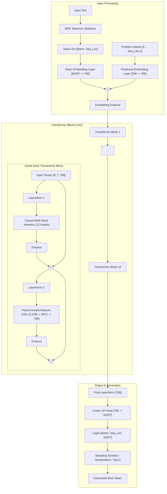

# Building Large Language Models

A modular PyTorch implementation of an autoregressive, decoder-only Large Language Model (LLM) following the GPT architecture. The repository provides first-principles implementations of subword tokenization, multi-head causal attention, Transformer blocks, pretraining on unlabeled corpora, and instruction fine-tuning on task datasets.

---

## Table of Contents

- [Project Overview](#project-overview)
- [Architecture Overview](#architecture-overview)
- [Capabilities](#capabilities)
- [Repository Structure](#repository-structure)
- [Module Descriptions](#module-descriptions)
- [Model Specifications](#model-specifications)
- [Training and Fine-Tuning Pipelines](#training-and-fine-tuning-pipelines)
  - [Pretraining Pipeline](#pretraining-pipeline)
  - [Instruction Fine-Tuning Pipeline](#instruction-fine-tuning-pipeline)
  - [Inference and Generation](#inference-and-generation)
- [Technology Stack](#technology-stack)
- [Installation and Setup](#installation-and-setup)
- [Usage Guide](#usage-guide)
- [Verification and Testing](#verification-and-testing)
- [Current Limitations](#current-limitations)
- [Future Development](#future-development)
- [License](#license)

---

## Project Overview

This repository implements the end-to-end pipeline required to construct, train, and fine-tune a GPT-style autoregressive language model. The codebase is organized into self-contained modules that progress logically from data ingestion and tokenization to attention mechanisms, full model architecture assembly, pretraining, and instruction alignment.

Key objectives:
- **First-Principles Implementation**: Core components—including scaled dot-product attention, causal masking, multi-head projection, layer normalization, GELU activation, and autoregressive generation—are implemented directly in PyTorch without high-level library abstractions.
- **End-to-End Pipeline**: Includes data preprocessing, sliding-window sampling, unsupervised next-token pretraining, instruction fine-tuning with masked loss, and checkpoint management.
- **Hardware-Aware Design**: Optimized for resource-constrained environments (such as 4 GB VRAM GPUs) using configurable sequence lengths, gradient accumulation, and memory-efficient batching.

---

## Architecture Overview

The model follows a decoder-only Transformer design with Pre-LayerNorm residual connections, causal self-attention, and position-wise feed-forward networks.



---

## Capabilities

### Implemented Functionality

- **Tokenization**:
  - Regex-based word tokenization with punctuation isolation.
  - Vocabulary mapping with bidirectional lookups (`str_to_int`, `int_to_str`).
  - Out-of-vocabulary handling with `<|unk|>` and document boundary delimitation with `<|endoftext|>`.
  - Byte Pair Encoding (BPE) integration using the GPT-2 50,257-token vocabulary.
- **Attention Mechanisms**:
  - Scaled dot-product self-attention with query, key, and value projections.
  - Causal masking using upper-triangular infinite masks to prevent future-token leakage.
  - Multi-head self-attention with tensor reshaping for parallel head computation.
- **Transformer Architecture**:
  - Gaussian Error Linear Unit (GELU) activation function with tanh approximation.
  - Position-wise feed-forward network with $4\times$ hidden dimension expansion ($768 \to 3072 \to 768$).
  - Pre-LayerNorm configuration for stable gradient propagation across deep networks.
  - Residual shortcut connections verified through gradient magnitude preservation.
  - Full `GPTModel` class assembling embeddings, 12 transformer blocks, final normalization, and linear output head.
- **Training & Pretraining**:
  - Causal sliding-window dataset sampling with configurable sequence lengths and strides.
  - Autoregressive pretraining loop with AdamW optimizer, learning rate scheduling, and cross-entropy loss tracking.
  - Checkpoint serialization preserving both model weights and optimizer states.
- **Instruction Fine-Tuning**:
  - Stanford Alpaca prompt formatting (`### Instruction:`, `### Input:`, `### Response:`).
  - Target loss masking with `ignore_index = -100` ensuring loss is evaluated strictly on generated responses.
  - Memory-efficient batch collation with sequence length clamping ($\le 256$ tokens) for 4 GB GPUs.
- **Inference & Text Generation**:
  - Greedy decoding (`argmax`).
  - Probabilistic generation with temperature scaling.
  - Top-$k$ candidate filtering.
  - Early stopping on `<|endoftext|>` token emission.

---

## Repository Structure

```text
BuildingLargeLanguageModel/
├── README.md                           # Primary project documentation
├── pyproject.toml                      # Project metadata and build configuration
├── requirements.txt                    # Project dependencies
├── uv.lock                             # Resolved dependency lockfile
└── src/
    ├── Plots/                          # Generated loss curves and analysis plots
    │   ├── finetune_loss-plot.pdf      # Fine-tuning loss curve
    │   ├── loss-plot.pdf               # Pretraining loss curve
    │   └── temperature-plot.pdf        # Sampling temperature comparison plot
    └── buildinglargelanguagemodel/
        ├── __init__.py                 # Package initialization
        ├── download_dataset.py         # Utility script for dataset retrieval
        ├── 3M_Model/                   # Pretrained model checkpoint artifacts
        │   ├── model.pth               # Pretrained weights (162.4M parameters)
        │   └── model_and_optimizer.pth # Pretrained checkpoint with AdamW states
        ├── instruction_model/          # Fine-tuned model checkpoint artifacts
        │   ├── config.json             # Architecture hyperparameters
        │   ├── instruction_model.pth   # Fine-tuned weights (162.4M parameters)
        │   └── instruction_checkpoint.pth # Full fine-tuning checkpoint with optimizer states
        ├── Attention/                  # Self-attention module implementations
        │   ├── self_attention_mech.ipynb       # Scaled dot-product self-attention
        │   ├── causal_self_attention.ipynb     # Causal self-attention with lower-triangular mask
        │   └── multihead_self_attention.ipynb  # Causal multi-head self-attention
        ├── Normalization/              # Normalization implementations
        │   └── norm.ipynb              # Layer normalization mechanics and verification
        ├── tokenizer/                  # Tokenizer implementations and input pipelines
        │   ├── tokenizer.ipynb         # Word tokenization, vocabulary mapping, V1 and V2
        │   └── Bpt.ipynb               # BPE tokenization, sliding window sampling, embeddings
        ├── LLM/                        # Architecture, training, and fine-tuning pipelines
        │   ├── llm_architecture.ipynb  # Unified GPTModel, Transformer blocks, and generation
        │   ├── pre_training.ipynb      # Unsupervised pretraining on TinyStories (~3M tokens)
        │   └── fine_tuining_llm.ipynb  # Instruction fine-tuning on Stanford Alpaca (~3M tokens)
        └── data/                       # Datasets used across training pipelines
            ├── the-verdict.txt         # Text corpus for tokenizer prototyping
            ├── train.txt               # TinyStories corpus for pretraining
            └── instruction_tuning/
                └── alpaca-train.arrow  # Stanford Alpaca instruction dataset (Arrow format)
```

---

## Module Descriptions

### 1. Tokenizer Module (`src/buildinglargelanguagemodel/tokenizer/`)

- **`tokenizer.ipynb`**:
  - Implements word-level tokenization using regular expression splitting on punctuation (`[,.:;?_!"()']`) and em dashes (`--`).
  - Constructs bidirectional vocabulary tables mapping unique tokens to integer identifiers.
  - Implements `SimpleTokenizerV1` for encoding and decoding.
  - Implements `SimpleTokenizerV2` with `<|unk|>` for out-of-vocabulary fallback and `<|endoftext|>` for sequence separation.
- **`Bpt.ipynb`**:
  - Implements Byte Pair Encoding (BPE) using `tiktoken` with the 50,257-token GPT-2 vocabulary.
  - Implements `GPTDatasetV1` and `create_dataloader_v1` using PyTorch `Dataset` and `DataLoader` with sliding-window extraction.
  - Implements `nn.Embedding` token projection and learned absolute positional embedding layers, verifying their element-wise summation.

### 2. Attention Module (`src/buildinglargelanguagemodel/Attention/`)

- **`self_attention_mech.ipynb`**:
  - Implements `SelfAttention` with linear projection matrices $W_q, W_k, W_v \in \mathbb{R}^{d_{in} \times d_{out}}$.
  - Computes attention scores using scaled dot products $\frac{QK^T}{\sqrt{d_k}}$ normalized across sequence length via softmax.
- **`causal_self_attention.ipynb`**:
  - Implements `CausalAttention` with upper-triangular masking (`torch.triu(..., diagonal=1)` filled with $-\infty$) to enforce autoregressive causality.
  - Incorporates attention dropout for regularization.
- **`multihead_self_attention.ipynb`**:
  - Implements `CausalMultiHeadSelfAttention` splitting input channels into $h$ heads of dimension $d_{head} = d_{model} / h$.
  - Computes all attention heads in parallel using tensor reshaping `(B, T, d_model) -> (B, h, T, d_head)`.
  - Concatenates head representations and applies a final output linear projection $W_o \in \mathbb{R}^{d_{model} \times d_{model}}$.

### 3. Normalization Module (`src/buildinglargelanguagemodel/Normalization/`)

- **`norm.ipynb`**:
  - Demonstrates statistical standardization across the channel/feature dimension (`dim=-1`).
  - Evaluates sample mean $\mu$ and variance $\sigma^2$ across activations, verifying zero mean and unit variance after layer normalization.

### 4. LLM Core Module (`src/buildinglargelanguagemodel/LLM/`)

- **`llm_architecture.ipynb`**:
  - Implements `GELU` activation using the tanh approximation.
  - Implements `FeedForward` network expanding hidden dimensions by a factor of 4 ($768 \to 3072 \to 768$).
  - Implements custom `LayerNorm` with learnable scale $\gamma$ and shift $\beta$ parameters.
  - Implements `TransformerBlock` with Pre-LayerNorm, residual connections, causal multi-head attention, and feed-forward layers.
  - Implements `GPTModel` integrating token embeddings, positional embeddings, 12 transformer blocks, final normalization, and linear output projection.
  - Implements `generate_text_simple` for autoregressive greedy decoding.
- **`pre_training.ipynb`**:
  - Ingests ~3M tokens from TinyStories (`data/train.txt`).
  - Configures sliding-window `GPTDatasetV1` (`context_length = 256`, `stride = 128`).
  - Defines cross-entropy loss over flattened vocabulary logits.
  - Executes the pretraining loop with AdamW optimizer (`lr = 5e-4`, `weight_decay = 0.1`).
  - Implements advanced generation with temperature scaling, top-$k$ sampling, and EOS stopping.
  - Serializes checkpoints to `3M_Model/model.pth` and `model_and_optimizer.pth`.
- **`fine_tuining_llm.ipynb`**:
  - Ingests ~3M tokens (27,054 samples) from the Stanford Alpaca dataset (`alpaca-train.arrow`).
  - Formats instructions using the standard Alpaca prompt template.
  - Implements `custom_collate_fn` with prompt target masking (`ignore_index = -100`) and length clamping ($\le 256$).
  - Loads pretrained weights from `3M_Model/model.pth`.
  - Executes instruction fine-tuning for 1 epoch using AdamW (`lr = 5e-5`, `weight_decay = 0.1`, `batch_size = 2`).
  - Evaluates unseen test instructions qualitatively against ground-truth targets.
  - Serializes fine-tuned weights to `instruction_model/instruction_model.pth` and `instruction_checkpoint.pth`.

---

## Model Specifications

The architecture implemented, pretrained, and fine-tuned across the repository matches a 162M parameter configuration:

| Hyperparameter | Configuration Value | Description |
| :--- | :--- | :--- |
| `vocab_size` | **50,257** | Subword vocabulary entries via GPT-2 BPE (`tiktoken`) |
| `context_length` | **256** | Maximum sequence context length ($T_{\max}$) |
| `emb_dim` | **768** | Hidden embedding dimension ($d_{model}$) |
| `n_heads` | **12** | Attention heads ($d_{head} = 768 / 12 = 64$) |
| `n_layers` | **12** | Stacked Transformer blocks |
| `drop_rate` | **0.0 / 0.1** | Dropout probability (0.1 during pretraining; 0.0 for inference/fine-tuning) |
| `qkv_bias` | **False** | Bias disabled in Q, K, V linear projections |
| **Total Parameters** | **162,419,712** | Complete trainable parameter count (~162.4M) |

---

## Training and Fine-Tuning Pipelines

### Pretraining Pipeline

The pretraining pipeline trains the model from scratch on causal next-token prediction:
1. **Corpus**: ~3,000,000 tokens extracted from the TinyStories dataset, sliced cleanly at `<|endoftext|>` boundaries.
2. **Sampling**: Sliding-window chunking with sequence length 256 and stride 128, creating overlapping input-target pairs.
3. **Optimization**:
   - Optimizer: `AdamW` (`lr = 5e-4`, `weight_decay = 0.1`).
   - Loss Function: Cross-entropy over next-token vocabulary distributions.
   - Batch Size: 4 (with training and validation splits).
4. **Convergence**:
   - Starting Loss: ~`10.98`
   - Final Training Loss: ~`4.20`
5. **Artifacts**: Checkpoints saved to `src/buildinglargelanguagemodel/3M_Model/model.pth` and `model_and_optimizer.pth`.

### Instruction Fine-Tuning Pipeline

The instruction fine-tuning pipeline adapts the pretrained checkpoint to follow instructions:
1. **Dataset**: Stanford Alpaca dataset (`alpaca-train.arrow`), truncated to 27,054 rows (~3,000,000 tokens).
2. **Prompt Template**:
   ```text
   Below is an instruction that describes a task. Write a response that appropriately completes the request.

   ### Instruction:
   {instruction}

   ### Input:
   {input}

   ### Response:
   {output}
   ```
3. **Target Masking**: Prompt token targets are replaced with `-100`, directing PyTorch's `cross_entropy(..., ignore_index=-100)` to compute gradients exclusively on response tokens.
4. **Optimization**:
   - Optimizer: `AdamW` (`lr = 5e-5`, `weight_decay = 0.1`).
   - Batch Size: 2 (safely fits within 4 GB VRAM without out-of-memory errors).
   - Epochs: 1 epoch (11,497 training steps).
5. **Convergence**:
   - Initial Loss: `10.18` (Train) / `10.42` (Val)
   - Final Loss: ~`3.80` (Train) / ~`4.48` (Val)
6. **Artifacts**: Checkpoints saved to `src/buildinglargelanguagemodel/instruction_model/instruction_model.pth`, `instruction_checkpoint.pth`, and `config.json`.

### Inference and Generation

Text generation is supported through deterministic greedy decoding and probabilistic sampling:
- **Greedy Decoding**: Selects $\arg\max$ of output logits at each step.
- **Temperature Scaling**: Scales logits by $1 / T$ before softmax. Low temperatures ($T < 1.0$) sharpen the distribution, while higher temperatures ($T > 1.0$) increase diversity.
- **Top-$k$ Sampling**: Restricts probability mass to the top $k$ highest-scoring tokens, filtering out unlikely tail candidates.
- **Context Clamping**: Automatically slices inputs to the trailing `context_size` tokens (`idx[:, -context_size:]`), ensuring sequences never exceed the context window.

---

## Technology Stack

- **Language**: Python 3.12+
- **Deep Learning Framework**: PyTorch 2.0+
- **Tokenization**: `tiktoken` (BPE tokenizer)
- **Data Handling**: Hugging Face `datasets` (Arrow reader), `numpy`
- **Visualization**: `matplotlib`
- **Package Management**: `uv`, `pip`
- **Environment**: Linux, CUDA 12+ / CPU

---

## Installation and Setup

### Prerequisites

- Python 3.12 or newer
- NVIDIA GPU with CUDA support (recommended for training; CPU supported for inference and architecture tests)

### Step 1: Clone the Repository

```bash
git clone https://github.com/Lakshay1221-apple/BuildingLargeLanguageModel.git
cd BuildingLargeLanguageModel
```

### Step 2: Create a Virtual Environment

Using `uv` (recommended):
```bash
uv venv
source .venv/bin/activate
uv pip install -r requirements.txt
```

Or using standard Python `venv`:
```bash
python3 -m venv .venv
source .venv/bin/activate
pip install -r requirements.txt
```

### Step 3: Launch JupyterLab

```bash
jupyter lab
```

---

## Usage Guide

### Loading the Pretrained Model for Generation

```python
import torch
import json
import tiktoken
def import_from_ipynb(nb_path, *names):
    import json
    with open(nb_path, 'r', encoding='utf-8') as f:
        nb_data = json.load(f)
    skip = ['logits = model(batch)', 'start_context =', 'layer_sizes =', 'batch = torch.tensor',
            'out_ffn = ffn(', 'out_att = att(', 'out_block = block(', 'ln_out = ln(',
            'y_gelu = gelu(x)', 'total_params = sum(', 'token_ids = generate_text_simple(']
    code = '

'.join(''.join(c['source']) for c in nb_data['cells']
                         if c['cell_type'] == 'code' and not any(s in ''.join(c['source']) for s in skip))
    scope = {}
    exec(code, scope)
    return [scope[n] for n in names]

GPTModel, = import_from_ipynb('src/buildinglargelanguagemodel/LLM/llm_architecture.ipynb', 'GPTModel')

BASE_CONFIG = {
    "vocab_size": 50257,
    "context_length": 256,
    "emb_dim": 768,
    "n_heads": 12,
    "n_layers": 12,
    "drop_rate": 0.0,
    "qkv_bias": False
}

device = torch.device("cuda" if torch.cuda.is_available() else "cpu")
tokenizer = tiktoken.get_encoding("gpt2")

# Initialize and load pretrained 162M weights
model = GPTModel(BASE_CONFIG)
checkpoint = torch.load("src/buildinglargelanguagemodel/3M_Model/model.pth", map_location=device, weights_only=True)
model.load_state_dict(checkpoint)
model.to(device)
model.eval()

# Generate text
prompt = "Once upon a time in a quiet forest,"
input_ids = torch.tensor(tokenizer.encode(prompt)).unsqueeze(0).to(device)

with torch.no_grad():
    for _ in range(30):
        idx_cond = input_ids[:, -256:]
        logits = model(idx_cond)[:, -1, :]
        idx_next = torch.argmax(logits, dim=-1, keepdim=True)
        input_ids = torch.cat((input_ids, idx_next), dim=1)

output_text = tokenizer.decode(input_ids.squeeze(0).tolist())
print(output_text)
```

### Loading the Fine-Tuned Instruction Model

```python
# Load fine-tuned instruction model
model = GPTModel(BASE_CONFIG)
checkpoint = torch.load("src/buildinglargelanguagemodel/instruction_model/instruction_model.pth", map_location=device, weights_only=True)
model.load_state_dict(checkpoint)
model.to(device)
model.eval()

instruction_prompt = """Below is an instruction that describes a task. Write a response that appropriately completes the request.

### Instruction:
Give three tips for staying healthy.

### Response:
"""

input_ids = torch.tensor(tokenizer.encode(instruction_prompt)).unsqueeze(0).to(device)

# Generate response with top-k sampling
with torch.no_grad():
    for _ in range(50):
        idx_cond = input_ids[:, -256:]
        logits = model(idx_cond)[:, -1, :]
        top_logits, _ = torch.topk(logits, k=25)
        min_val = top_logits[:, -1]
        logits = torch.where(logits < min_val, torch.tensor(float("-inf"), device=logits.device), logits)
        probs = torch.softmax(logits / 0.7, dim=-1)
        idx_next = torch.multinomial(probs, num_samples=1)
        if idx_next.item() == 50256:
            break
        input_ids = torch.cat((input_ids, idx_next), dim=1)

print(tokenizer.decode(input_ids.squeeze(0).tolist()))
```

---

## Verification and Testing

Each notebook contains verification blocks testing tensor shapes, data types, and numerical stability:

1. **Attention Verification**:
   - `self_attention_mech.ipynb`: Asserts projection output shape `(1, 3, 2)` from input `(1, 3, 4)`.
   - `causal_self_attention.ipynb`: Confirms upper-triangular masking zeroes out post-diagonal probabilities.
   - `multihead_self_attention.ipynb`: Asserts multi-head output shape `(2, 8, 256)` matches input shape.
2. **Normalization Verification**:
   - `norm.ipynb`: Asserts feature mean evaluates to $\approx 0.0$ and variance evaluates to $\approx 1.0$.
3. **Tokenizer Verification**:
   - `tokenizer.ipynb`: Confirms round-trip encoding/decoding and validates `<|unk|>` substitution on unseen words.
   - `Bpt.ipynb`: Confirms BPE token reconstruction and verifies sliding-window target shift ($y_t = x_{t+1}$).
4. **Architecture Verification**:
   - `llm_architecture.ipynb`: Confirms logits tensor shape `(2, 8, 50257)` across batch inputs, evaluates parameter count (163,009,536), and runs greedy generation.
5. **CLI Verification Command**:
   Execute any notebook programmatically to verify execution from top to bottom:
   ```bash
   python3 -c "
   import json
   with open('src/buildinglargelanguagemodel/LLM/llm_architecture.ipynb') as f:
       nb = json.load(f)
   code = '\n\n'.join(''.join(c['source']) for c in nb['cells'] if c['cell_type'] == 'code')
   exec(code, {})
   print('Verification passed!')
   "
   ```

---

## Current Limitations

- **Context Window**: Trained checkpoints use a context window of 256 tokens to optimize training throughput within constrained compute budgets. The architecture supports arbitrary context lengths (e.g., 1,024), but positional embeddings require resizing for longer windows.
- **VRAM Constraints**: For GPUs with 4 GB VRAM (such as the GTX 1650), training batch sizes must be limited to 2 or 4 during fine-tuning to prevent out-of-memory errors during backpropagation.
- **Dataset Scale**: Pretraining and fine-tuning were performed on truncated subsets (~3M tokens each) to balance training time with representation learning. Full pretraining on large corpora (e.g., FineWeb, RedPajama) requires multi-GPU scaling.
- **KV Caching**: Current generation re-computes attention over the full sequence at each step ($O(N^2)$ inference). Key-value caching is not yet integrated into the forward pass.

---

## Future Development

- [ ] **Key-Value (KV) Caching**: Implement KV cache in `CausalMultiHeadSelfAttention` to reduce autoregressive inference complexity from $O(N^2)$ to $O(N)$.
- [ ] **Pretrained Weight Loading**: Integrate loading utilities for pretrained OpenAI GPT-2 weights (124M, 355M, 774M, 1558M).
- [ ] **Parameter-Efficient Fine-Tuning (PEFT)**: Add Low-Rank Adaptation (LoRA) to enable fine-tuning on larger models with minimal memory overhead.
- [ ] **FlashAttention**: Integrate PyTorch scaled dot-product attention (`F.scaled_dot_product_attention`) for memory-efficient kernel execution.
- [ ] **Preference Alignment**: Implement Direct Preference Optimization (DPO) for model alignment.

---

## License

This project is licensed under the MIT License - see the LICENSE file for details.
