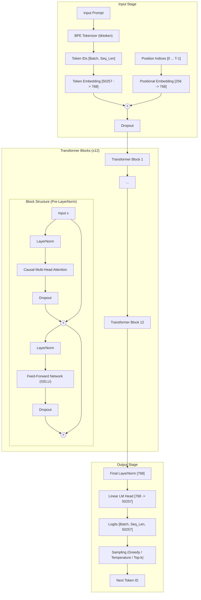

# Building Large Language Models

A modular PyTorch implementation of an autoregressive, decoder-only Large Language Model (LLM) based on the GPT architecture. The repository covers the complete pipeline from tokenization and attention mechanisms to full model assembly, unsupervised pretraining, and instruction fine-tuning.

---

## Table of Contents

- [Overview](#overview)
- [Architecture](#architecture)
- [Features](#features)
- [Repository Structure](#repository-structure)
- [Implementation Details](#implementation-details)
- [Model Configuration](#model-configuration)
- [Training Pipeline](#training-pipeline)
- [Checkpoint Artifacts](#checkpoint-artifacts)
- [Installation](#installation)
- [Usage](#usage)
- [Verification](#verification)
- [Limitations](#limitations)
- [Roadmap](#roadmap)
- [License](#license)

---

## Overview

This repository implements a functional GPT-style language model from scratch using pure PyTorch. Rather than relying on high-level library abstractions, each core component is built and verified directly to provide a clear, executable reference for how modern autoregressive Transformers process language.

The project encompasses the full model lifecycle:
1. **Input Preparation**: Text preprocessing, vocabulary building, subword Byte Pair Encoding (BPE), and sliding-window dataset collation.
2. **Model Architecture**: Scaled dot-product attention, causal masking, multi-head projections, Pre-LayerNorm residual blocks, and linear output projection.
3. **Training**: Causal next-token pretraining on unlabeled narrative text, followed by supervised instruction fine-tuning with prompt loss masking.
4. **Inference**: Autoregressive text generation supporting greedy decoding, temperature scaling, and top-$k$ candidate sampling.

---

## Architecture

The model follows a decoder-only Transformer design with Pre-LayerNorm residual connections, causal self-attention, and position-wise feed-forward networks.



### Data Flow

1. Input text is tokenized into integer IDs using GPT-2 Byte Pair Encoding.
2. Token IDs and position indices are projected into 768-dimensional continuous vector embeddings and summed.
3. The embedded representations pass through 12 stacked Transformer blocks. Within each block:
   - Activations are normalized via LayerNorm before multi-head causal attention (**Pre-LayerNorm**).
   - Multi-head attention routes contextual information across 12 heads in parallel with an upper-triangular causal mask.
   - A residual connection adds the block input to the attention output.
   - A second LayerNorm normalizes activations before entering the feed-forward network ($768 \to 3072 \to 768$) with GELU activation.
   - A second residual connection adds the feed-forward output to the intermediate representation.
4. Activations undergo a final LayerNorm pass and are projected by the linear language model head into vocabulary logits ($50,257$ dimensions).
5. Output logits are converted to probabilities for token sampling.

---

## Features

- **Custom & Subword Tokenizers**: Regular-expression word tokenizer with `<|unk|>` and `<|endoftext|>` support, alongside production-grade GPT-2 Byte Pair Encoding via `tiktoken`.
- **Causal Multi-Head Attention**: Linear $Q, K, V$ projections with batched matrix multiplication, causal triangular masking, and linear output projection.
- **Pre-LayerNorm Transformer Blocks**: Modern Pre-LN architecture providing stable gradient flow throughout depth.
- **Sliding-Window Data Loading**: Efficient dataset streaming using PyTorch `Dataset` and `DataLoader` with configurable sequence length and stride.
- **Two-Stage Training**:
  - *Pretraining*: Causal next-token prediction on unlabeled narrative text.
  - *Instruction Fine-Tuning*: Task alignment on instruction-response pairs with prompt loss masking (`ignore_index = -100`).
- **Flexible Text Generation**: Autoregressive decoding supporting deterministic greedy selection, temperature scaling, top-$k$ filtering, and early stopping on `<|endoftext|>`.
- **Checkpoint Management**: Clean separation of lightweight inference weights (`.pth`), complete training checkpoints with optimizer states, and configuration metadata (`config.json`).

---

## Repository Structure

```text
BuildingLargeLanguageModel/
├── pyproject.toml              # Build metadata and dependencies
├── requirements.txt            # Python dependencies
├── uv.lock                     # Resolved dependency lockfile
├── README.md                   # Project documentation
└── src/
    ├── Plots/                  # Training curves and visualization plots
    └── buildinglargelanguagemodel/
        ├── tokenizer/          # Word-level and BPE tokenization pipelines
        ├── Attention/          # Scaled dot-product, causal, and multi-head attention
        ├── Normalization/      # Layer normalization mechanics
        ├── LLM/                # Model architecture, pretraining, and fine-tuning
        ├── 3M_Model/           # Pretrained checkpoint artifacts
        ├── instruction_model/  # Fine-tuned checkpoint artifacts
        └── data/               # Training corpora and instruction datasets
```

### Directory Responsibilities

- **`tokenizer/`**: Implements custom regular-expression tokenization, vocabulary mapping, and BPE integration with PyTorch sliding-window dataset loaders.
- **`Attention/`**: Implements scaled dot-product attention, causal masking, and multi-head parallel attention projections.
- **`Normalization/`**: Demonstrates the mechanics and statistical properties of layer normalization.
- **`LLM/`**: Contains the core `GPTModel` architecture, the unsupervised pretraining pipeline, and the instruction fine-tuning pipeline.
- **`3M_Model/`**: Stores weights and training states from the pretraining phase.
- **`instruction_model/`**: Stores weights, training states, and configuration from the instruction fine-tuning phase.
- **`data/`**: Holds text corpora used across pipelines, including *The Verdict* (tokenization), TinyStories (pretraining), and Stanford Alpaca (fine-tuning).
- **`Plots/`**: Stores generated training and validation loss curves.

---

## Implementation Details

### Tokenization and Data Pipelines

- **Regular Expression Tokenizer (`tokenizer.ipynb`)**: Splits text on whitespace and punctuation marks (`[,.:;?_!"()']`), preventing punctuation from merging with adjacent words. Vocabulary construction maps unique tokens to integer IDs, implementing `<|unk|>` for out-of-vocabulary handling and `<|endoftext|>` as a document delimiter.
- **Byte Pair Encoding (`Bpt.ipynb`)**: Integrates `tiktoken` with the 50,257-token GPT-2 vocabulary. Implements `GPTDatasetV1` to extract overlapping sequence pairs $(x, y)$ where targets are shifted by one position ($y_t = x_{t+1}$) across a sliding window.
- **Input Embeddings (`Bpt.ipynb`)**: Projects discrete token IDs into 768-dimensional vector spaces and adds learned absolute positional embeddings to provide sequence order information.

### Attention Mechanisms

- **Scaled Dot-Product Attention (`self_attention_mech.ipynb`)**: Projects inputs into Query ($Q$), Key ($K$), and Value ($V$) matrices. Attention weights are computed via $\text{softmax}(QK^T / \sqrt{d_k})$ and multiplied by $V$.
- **Causal Masking (`causal_self_attention.ipynb`)**: Applies an upper-triangular mask of $-\infty$ to raw attention scores prior to softmax, ensuring each position attends only to current and preceding tokens.
- **Multi-Head Attention (`multihead_self_attention.ipynb`)**: Splits the 768 hidden dimensions into 12 attention heads ($d_{head} = 64$) computed in parallel using tensor reshaping `(B, T, d_model) -> (B, h, T, d_head)`. Head outputs are concatenated and projected through a final linear layer $W_o$.

### Normalization and Activation

- **Layer Normalization (`norm.ipynb`, `llm_architecture.ipynb`)**: Normalizes activations across the feature dimension (`dim=-1`) for each token independently, using learnable scale ($\gamma$) and shift ($\beta$) parameters with numerical epsilon ($10^{-5}$).
- **GELU Activation (`llm_architecture.ipynb`)**: Implements the Gaussian Error Linear Unit using the tanh approximation, providing smooth non-linearities for the feed-forward network.

### Transformer Blocks and Full GPT Model

- **TransformerBlock (`llm_architecture.ipynb`)**: Combines Pre-LayerNorm, causal multi-head attention, dropout, and feed-forward networks ($768 \to 3072 \to 768$). Residual connections are implemented around both sub-blocks to preserve information flow and improve gradient propagation.
- **GPTModel (`llm_architecture.ipynb`)**: Assembles token embeddings, positional embeddings, 12 sequential Transformer blocks, final LayerNorm, and a linear output projection head mapping representations to vocabulary logits.

---

## Model Configuration

The architecture implemented, pretrained, and fine-tuned across the repository uses the following configuration:

| Configuration | Value |
| :--- | :--- |
| Vocabulary size | 50,257 |
| Context length | 256 |
| Embedding dimension | 768 |
| Transformer layers | 12 |
| Attention heads | 12 |
| Head dimension | 64 |
| Feed-forward expansion | 4× (3,072) |
| Dropout rate | 0.0 (eval/fine-tune) / 0.1 (pretrain) |
| Query-Key-Value bias | False |
| Total parameters | 162,419,712 (~162.4M) |

*Note: While the architecture code supports arbitrary context lengths (e.g., 1,024), the trained checkpoints use a 256-token context window to match the compute budget and training datasets.*

---

## Training Pipeline

The repository separates training into two distinct, sequential phases:

```
Unlabeled Text Corpus (TinyStories)
       │
       ▼
[ Pretraining Pipeline ] ──────────────► Pretrained Weights (3M_Model/model.pth)
                                                       │
Instruction-Response Pairs (Alpaca)                    │
       │                                               │
       ▼                                               ▼
[ Instruction Fine-Tuning Pipeline ] ◄─────────────────┘
       │
       ▼
Fine-Tuned Instruction Model (instruction_model/instruction_model.pth)
```

### 1. Pretraining

Pretraining trains the model from scratch on causal next-token prediction to learn language syntax, vocabulary, and factual patterns.

- **Corpus**: ~3,000,000 tokens extracted from the TinyStories dataset, truncated at `<|endoftext|>` boundaries.
- **Data Loading**: Sliding-window chunking with sequence length 256 and stride 128.
- **Optimization**: AdamW optimizer with learning rate $5 \times 10^{-4}$ and weight decay $0.1$.
- **Loss**: Standard cross-entropy loss over vocabulary logits across all sequence positions.
- **Outcome**: Training loss converged from an initial value of ~`10.98` down to ~`4.20`.
- **Output Artifacts**: Saved to `src/buildinglargelanguagemodel/3M_Model/`.

### 2. Instruction Fine-Tuning

Instruction fine-tuning adapts the pretrained model to follow user instructions rather than continuing text arbitrarily.

- **Dataset**: Stanford Alpaca dataset, formatted and truncated to 27,054 examples (~3,000,000 tokens).
- **Prompt Structure**:
  ```text
  Below is an instruction that describes a task. Write a response that appropriately completes the request.

  ### Instruction:
  {instruction}

  ### Input:
  {input}

  ### Response:
  {output}
  ```
- **Response-Only Loss Masking**: In `custom_collate_fn`, prompt tokens in the target tensor are replaced with `-100`. PyTorch's cross-entropy loss ignores targets with index `-100`, ensuring gradients are computed strictly on generated response tokens.
- **Optimization**: AdamW optimizer with learning rate $5 \times 10^{-5}$, weight decay $0.1$, and batch size 2.
- **Outcome**: Training loss converged from `10.18` down to ~`3.80`, with validation loss tracking to ~`4.48`.
- **Output Artifacts**: Saved to `src/buildinglargelanguagemodel/instruction_model/`.

---

## Checkpoint Artifacts

The repository manages model checkpoints across three distinct artifact types:

1. **Pretrained Model Weights (`src/buildinglargelanguagemodel/3M_Model/model.pth`)**:
   - Size: ~620 MB.
   - Contains the state dictionary (`model.state_dict()`) after pretraining.
   - Used for raw text generation or as the base model for fine-tuning.
2. **Fine-Tuned Model Weights (`src/buildinglargelanguagemodel/instruction_model/instruction_model.pth`)**:
   - Size: ~620 MB.
   - Contains the state dictionary after instruction fine-tuning.
   - Used for instruction-following inference and task completion.
3. **Training Checkpoints (`model_and_optimizer.pth` / `instruction_checkpoint.pth`)**:
   - Size: ~1.86 GB each.
   - Preserves model parameters, AdamW momentum and variance states, and configuration metadata.
   - Used to resume training or inspect optimization states.

---

## Installation

### Prerequisites

- Python 3.12 or newer.
- An NVIDIA GPU with CUDA support is recommended for training and fine-tuning.
- CPU is fully supported for architecture inspection, component testing, and inference.

### Setup Using `uv` (Recommended)

```bash
# Clone the repository
git clone https://github.com/Lakshay1221-apple/BuildingLargeLanguageModel.git
cd BuildingLargeLanguageModel

# Sync environment and install dependencies
uv sync

# Launch JupyterLab
uv run jupyter lab
```

### Setup Using Standard `pip`

```bash
# Clone the repository
git clone https://github.com/Lakshay1221-apple/BuildingLargeLanguageModel.git
cd BuildingLargeLanguageModel

# Create and activate virtual environment
python3 -m venv .venv
source .venv/bin/activate

# Install dependencies
pip install -r requirements.txt

# Launch JupyterLab
jupyter lab
```

---

## Usage

### Interactive Notebook Workflow

The primary environment for running experiments, visualizing loss curves, and inspecting components is JupyterLab:

1. Open `src/buildinglargelanguagemodel/Attention/` to inspect and test attention mechanisms.
2. Open `src/buildinglargelanguagemodel/LLM/llm_architecture.ipynb` to verify the full 162M parameter model architecture.
3. Open `src/buildinglargelanguagemodel/LLM/pre_training.ipynb` to inspect pretraining and text generation.
4. Open `src/buildinglargelanguagemodel/LLM/fine_tuining_llm.ipynb` to run instruction fine-tuning and evaluate model responses.

### Loading Checkpoints for Generation

The trained model checkpoints can be loaded directly using PyTorch:

```python
import torch
import tiktoken
from torch import nn

# 1. Define model configuration
CONFIG = {
    "vocab_size": 50257,
    "context_length": 256,
    "emb_dim": 768,
    "n_heads": 12,
    "n_layers": 12,
    "drop_rate": 0.0,
    "qkv_bias": False
}

device = torch.device("cuda" if torch.cuda.is_available() else "cpu")
tokenizer = tiktoken.get_encoding("gpt2")

# 2. Load model weights
# (Instantiate GPTModel from LLM/llm_architecture.ipynb)
checkpoint_path = "src/buildinglargelanguagemodel/instruction_model/instruction_model.pth"
state_dict = torch.load(checkpoint_path, map_location=device, weights_only=True)
model.load_state_dict(state_dict)
model.to(device)
model.eval()

# 3. Format instruction prompt
prompt = """Below is an instruction that describes a task. Write a response that appropriately completes the request.

### Instruction:
Give three tips for staying healthy.

### Response:
"""

input_ids = torch.tensor(tokenizer.encode(prompt)).unsqueeze(0).to(device)

# 4. Generate with top-k sampling
with torch.no_grad():
    for _ in range(50):
        idx_cond = input_ids[:, -CONFIG["context_length"]:]
        logits = model(idx_cond)[:, -1, :]
        
        # Apply top-k filtering
        top_logits, _ = torch.topk(logits, k=25)
        min_val = top_logits[:, -1]
        logits = torch.where(logits < min_val, torch.tensor(float("-inf"), device=device), logits)
        
        probs = torch.softmax(logits / 0.7, dim=-1)
        idx_next = torch.multinomial(probs, num_samples=1)
        
        if idx_next.item() == 50256:  # Stop on <|endoftext|>
            break
            
        input_ids = torch.cat((input_ids, idx_next), dim=1)

print(tokenizer.decode(input_ids.squeeze(0).tolist()))
```

---

## Verification

The implementations in this repository are verified through structured checks across components, architecture, and training pipelines:

### 1. Component Verification

- **Scaled Dot-Product Attention**: Asserts projection output shape `(1, 3, 2)` from input `(1, 3, 4)`.
- **Causal Attention Masking**: Confirms that post-diagonal entries in the attention score matrix are masked with $-\infty$, evaluating to zero probability after softmax.
- **Multi-Head Attention**: Confirms parallel computation across 12 heads and verifies that output dimensions `(2, 8, 256)` match input dimensions.
- **Layer Normalization**: Verifies feature standardization on sample batches, confirming normalized mean of $\approx 0.0$ and variance of $\approx 1.0$.
- **Tokenizers**: Validates lossless round-trip encoding/decoding and confirms that `<|unk|>` properly handles unseen words.

### 2. Model Verification

- **Forward Pass Shapes**: Confirms output logits shape `(2, 8, 50257)` across batch inputs in `llm_architecture.ipynb`.
- **Parameter Accounting**: Verifies the total model parameter count matches 162,419,712 parameters (with ~85M parameters in the Transformer blocks).
- **Greedy Generation**: Confirms autoregressive token generation appends valid token IDs iteratively.

### 3. Training & Checkpoint Verification

- **Loss Calculation**: Verifies cross-entropy loss computation across flattened logits and target tokens.
- **Target Masking**: Validates that target prompt tokens masked with `-100` are ignored by the loss function during fine-tuning.
- **Checkpoint Integrity**: Checkpoint loading cells in `pre_training.ipynb` and `fine_tuining_llm.ipynb` reload saved state dictionaries and confirm parameter counts match the active architecture.

---

## Limitations

- **Context Window**: Trained checkpoints use a 256-token context length to enable rapid experimentation on local hardware. While the code supports larger contexts, positional embeddings are fixed to the configured sequence length.
- **Hardware Constraints**: On GPUs with 4 GB VRAM (such as the NVIDIA GTX 1650), fine-tuning requires small batch sizes (`batch_size = 2`) to fit activations and AdamW optimizer states within memory.
- **Dataset Scale**: Both pretraining and fine-tuning were conducted on ~3 million token subsets. While sufficient to demonstrate convergence and instruction formatting, full general-purpose capabilities require larger training corpora.
- **Inference Complexity**: Text generation currently evaluates the full sequence at each step ($O(N^2)$ complexity). Key-Value (KV) caching is not yet implemented.

---

## Roadmap

### Performance Optimizations

- [ ] **Key-Value (KV) Caching**: Store past key and value states to reduce generation complexity from $O(N^2)$ to $O(N)$.
- [ ] **FlashAttention Integration**: Use PyTorch's native `F.scaled_dot_product_attention` for fused, memory-efficient attention computation.

### Model Capabilities

- [ ] **Pretrained Weight Importer**: Implement weight conversion utilities to import official OpenAI GPT-2 weights (124M, 355M, 774M, 1558M).
- [ ] **Advanced Sampling**: Add nucleus sampling (top-$p$) and repetition penalties.

### Training Enhancements

- [ ] **Parameter-Efficient Fine-Tuning (PEFT)**: Implement Low-Rank Adaptation (LoRA) for lightweight fine-tuning.
- [ ] **Preference Alignment**: Implement Direct Preference Optimization (DPO) for response alignment.

---

## License

This project is licensed under the MIT License - see the LICENSE file for details.
